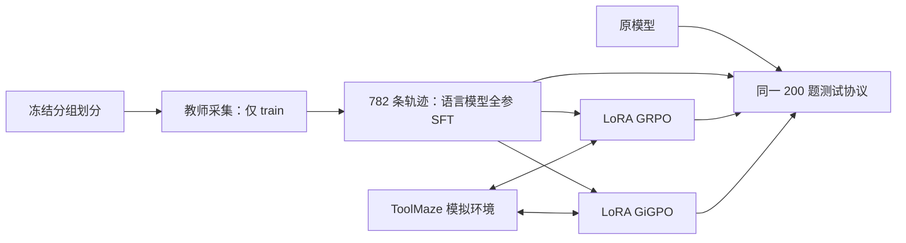

# 面向工具故障恢复的多轮 Agent 后训练

**ToolMaze × Qwen3.5-2B：教师轨迹蒸馏 → 全参数语言模型 SFT → LoRA GRPO / 步骤级 GiGPO → 统一评测与失败分析。**

项目研究多轮工具调用中的一个具体问题：遇到超时、永久性错误或格式正常但内容异常的返回时，小模型能否正确重试、切换路径、阻断错误传播，并解释未完成部分。

目前已完成数据划分、教师采集、SFT、两组 RL 和固定测试集评测。所有工具都在 **ToolMaze 模拟环境**中执行，未接入真实订票、支付、通知或交易服务，也不宣称支持任意新任务。

## 结果与阅读入口

**主结果已按 25 轮预算重新测评**：固定测试集 200 个任务实例，每题一次采样；使用最终权重，不按测试结果挑选 checkpoint。四组基础设施错误均为 0，所有请求保留在分母中。

| 模型 | 官方通过 | 严格通过 | 含协议错误的轨迹 | 达到 25 轮上限 |
|---|---:|---:|---:|---:|
| 原始 Qwen3.5-2B | 26/200（13.0%） | 13/200（6.5%） | 130 | 91 |
| 全参语言模型 SFT | 106/200（53.0%） | 88/200（44.0%） | 53 | 14 |
| SFT + LoRA GRPO | 110/200（55.0%） | 105/200（52.5%） | 21 | 5 |
| SFT + LoRA GiGPO | 114/200（57.0%） | 107/200（53.5%） | 24 | 2 |

25 轮主结果：GRPO 相对 SFT 的严格通过率变化为 +8.5 个百分点，GiGPO 相对 SFT 为 +9.5 个百分点。GiGPO 相对 GRPO：官方 +2.0、严格 +1.0 个百分点。两组训练 batch/更新数和恢复条件不同，且仅单 seed，不把该差异解释为纯算法因果效果。

严格通过要求：官方通过、有显式 `final_answer`、全程无动作协议或参数 schema 错误。它仍不验证全部业务语义；案例中保留了严格通过但虚构备份完成的反例。

- [实验报告：设计、配置、结果与归因边界](reports/project/experiment_report.md)
- [16 轮历史代表性轨迹：成功、双向分歧、共同失败、指标盲区](reports/project/representative_trajectories.md)
- [25 轮完整对照与 16/25 变化](reports/rl_eval/rounds25_20261027/comparison.md) / [25 轮逐题 CSV](reports/rl_eval/rounds25_20261027/paired_episodes.csv) / [16 轮历史结果](reports/rl_eval/grpo_vs_gigpo_20261027/comparison.md)
- [案例原始出处与 SHA-256 清单](reports/project/case_manifest.json)

## 任务、数据与防泄漏

ToolMaze 的 400 个底层任务 × 5 种模式组成 2,000 个实例；本项目使用全领域数据，出行只是其中一个场景。

| 模式 | 环境扰动 | 目标行为 |
|---|---|---|
| P0 | 无故障 | 按任务要求完成调用 |
| P1 | 暂时性显式错误 | 重试恢复，或采用允许的替代路径 |
| P2 | 永久性显式错误 | 有有效替代路径时换路，否则合理停止 |
| P3 | 暂时性隐式数据污染 | 核验内容、恢复后再推进 |
| P4 | 永久性隐式数据污染 | 避免继续传播异常数据，必要时停止 |

实际判分还区分 C1—C4 任务复杂度；P2/P4 不等于一律立即停止，有有效替代路径时可能必须完成替代路径。

采集前按 `template_id`、`task_id`、规范化 query 的连通分组冻结为 **train 1600 / validation 200 / test 200**。同一底层任务的 P0—P4 不跨集合，加载任务时校验 SHA-256。本轮验证集未用于搜索超参数或选择 checkpoint。

教师 `deepseek-v4.1-flash` 对全部训练实例各采样一次，最终并发数 64，验收 782 条，全部放入 8192-token 上下文，共 614,303 个监督 token。教师采用 Anthropic 原生工具调用，运行时真实执行模拟工具，再转换为学生 JSON 文本动作。因此，教师验收比例不是与学生完全同协议的 benchmark 成绩。

SFT 使用 782 条合格教师轨迹；RL 使用全部 1600 道训练题，含没有教师成功轨迹的 818 道题。SFT 与 RL 可以共享训练题，**但教师轨迹不替代在线学生 rollout，验证/测试不参与训练**。GRPO 的日志恢复例外详见下文。

证据：[数据审计](reports/teacher/sft_data_audit.json)、[SFT 数据 manifest](runs/sft_data/manifest.json)、[上游版本锁定](tools/upstream.lock.json)。

## 系统与算法



学生每次输出一个 JSON 动作，以 `</action>` 结束：

```json
{"type":"tool_call","tool_name":"TOOL","arguments":{}}
```

也可输出 `{"type":"final_answer","content":"..."}` 结束。运行时执行工具、追加 observation，再让模型决策。工具 schema 可见；标准路径、故障模式、注入标记和期望结果只在环境/判分侧使用。

提示和 observation 的 SFT label 为 `-100`。RL 的环境 token、padding、运行时补充 EOS 不直接作为策略损失位置；工具返回仍作为后续决策的上下文。mask 不意味着切断上下文计算图，动作损失仍可通过上下文计算影响参数梯度。

**SFT：** TRL `SFTTrainer` + DeepSpeed ZeRO-2，更新 1,881,825,088 个语言模型参数，冻结视觉模块，不使用 LoRA。监督损失采用分块输出头，避免完整大词表 logits 占用。

**GRPO：** 从 SFT 起点训练语言层投影的 LoRA，rank 64 / alpha 128，共 67,276,800 个可训练参数。每题采样 8 条轨迹，以组内回报计算轨迹级优势。vLLM 保存实际 token ID、采样 log-prob，TRL 对 vLLM/HF 概率差异做重要性校正。通过关闭 adapter 计算冻结 SFT 参考概率，KL beta=0.01。

**GiGPO：** 在相同终局奖励上加入同状态组的步骤优势：

$$
A_{i,t}=A_i^{episode}+\omega A_{i,t}^{step},\qquad
G_{i,t}=\gamma^{T_i-1-t}R_i
$$

本实现 `gamma=0.95, omega=1`，把终局奖励放在最后一个模型决策。在同任务、同 rollout group 内，对**完全相同策略输入 token 前缀**的动作比较后续折扣回报；单样本组、同回报组的步骤优势为 0。它不需要 PRM、critic 或额外分支采样。

这是对 [GiGPO / NeurIPS 2025](https://papers.neurips.cc/paper_files/paper/2025/file/420c9f777c0b4f78d515e53cf74d58b2-Paper-Conference.pdf) 思路的适配，**不是论文全部设置的逐项复现，也不是新提出 GiGPO**。精确前缀是保守状态定义，历史分叉后可能无法匹配等价环境状态。多卡版先汇总全局轨迹计算优势，再按 rank 切回，避免任务组被 GPU 边界拆分。

当前 Liger GRPO 内核只支持每轨迹一个优势，因此 GiGPO 使用支持逐 token 优势的 checkpointed 分块输出头损失。不能把步骤分数加总后继续当作原 GRPO，就宣称实现了步骤级信用分配。

奖励一致：严格通过时 `1 - min(0.002 × 工具调用次数, 0.2)`；失败时 `-0.1 × min(协议错误数 + schema 错误数, 5)`，没有这些错误的失败为 0。没有为任意“成功调用”额外发放正奖励。

## 关键配置与训练产物

| 项目 | SFT | GRPO | GiGPO |
|---|---|---|---|
| 起点 | 原始 Qwen3.5-2B | SFT final | 同一 SFT final |
| 数据 | 782 条教师合格轨迹 | 全部 1600 道训练题 | 同一 1600 道题 |
| 更新方式 | 全参语言模型 | LoRA r64 | LoRA r64 |
| 训练 GPU | 5 张 3090 | 4 张 3090 | 5 张 3090 |
| vLLM GPU | 无 | 额外 1 张 3090 | 额外 1 张 3090 |
| 有效 batch | 30 条序列 | 128 条轨迹 | 160 条轨迹 |
| 更新数 | 54，2 epochs | 100 | 80 |
| RL 轨迹预算 | — | 12800 | 12800 |

两组 RL 的 batch、更新步数和 warmup 样本跨度不同，相同轨迹预算**不构成严格算法消融**，也不能用运行耗时直接比较算法效率。

GRPO 曾在第 11 次采样连接中断，首轮前 10 步没有 checkpoint。最终 recovery run 重放先前保存的 1280 条学生轨迹和采样概率（包含失败，不筛选），重建前 10 步，之后继续在线采样；这不等于恢复已丢失的优化器状态。后来确实验证了 native optimizer/RNG checkpoint 恢复。[恢复证据](reports/rl/native_resume_validation.json)

最终权重：

- SFT：`runs/sft_full_trl_20261026/final`，链接至 `checkpoint-54`。
- GRPO：`runs/grpo_lora_recovery_20261026/final`。
- GiGPO：`runs/gigpo_full_20261027/final`。

RL final 是 adapter，仍需原 SFT 底座。SFT 只保存模型，不能精确恢复优化器；RL 每步保存 adapter、DeepSpeed optimizer、scheduler、RNG，保留最近两份，全部 rank 完成后写入 `checkpoint_complete.json`；恢复需相同 world size。

## 目录与核心实现

沿用脚本式组织，未引入 `src/`。

| 路径 | 内容 |
|---|---|
| `scripts/toolmaze_agent/` | 数据、协议、环境、训练与评测 |
| `scripts/toolmaze_agent/configs/` | YAML 与 DeepSpeed 配置 |
| `tools/` | 启动器、审计、案例导出；`ToolMaze/` 为固定上游源码 |
| `data/splits/toolmaze_v1/` | 冻结分组划分与任务哈希 |
| `runs/` | 原始轨迹、训练状态、checkpoint、评测结果 |
| `reports/project/` | 本报告、案例及历史 README 备份 |
| `artifacts/` | 模型/adapter/临时合并推理权重的来源与哈希 |
| `models/`、`.deps/` | 本地权重与项目内核依赖 |

重点阅读：[环境校验](scripts/toolmaze_agent/environment.py)、[交互循环与奖励](scripts/toolmaze_agent/rollout.py)、[GRPO 内存适配](scripts/toolmaze_agent/rl_trainer.py)、[GiGPO 优势计算](scripts/toolmaze_agent/gigpo.py)、[逐 token 损失](scripts/toolmaze_agent/gigpo_trainer.py)、[跨卡分组](scripts/toolmaze_agent/gigpo_distributed.py)、[评测](scripts/toolmaze_agent/eval.py)。

## 环境与复现入口

本机环境为 `sftrl`，已验证 Python 3.10、Torch 2.13.0+cu130、Transformers 5.10.4、TRL 1.13.0、DeepSpeed 0.19.7、PEFT 0.21.0、vLLM 0.29.0。依赖见 [requirements.txt](requirements.txt)、[SFT 内核依赖](requirements-sft-kernels.txt)、[RL 内核依赖](requirements-rl-kernels.txt)。TRL 对当前 vLLM 版本存在兼容范围警告；这里以实际测试和运行记录声明可运行，不代表上游承诺兼容。

```bash
cd program
conda activate sftrl
python tools/preflight.py
nvidia-smi
```

下面是本轮流程的入口，**不是要求覆盖已有实验**。新实验先复制配置、设置新的 `output`，后续模型路径指向新产物；启动前选择空闲卡，启动器也会检查占用。本地大模型、数据和 `.deps/` 不一定随代码仓库分发。

```bash
# 获取固定版本上游与数据。
python tools/bootstrap.py

# 教师凭据只在本地安全配置，不写入仓库；仅采集 train。
python tools/run_teacher.py --workers 64 --attempts 1
python -m scripts.toolmaze_agent.build_sft \
  --collection runs/teacher/opencode_v41_flash_20261026_native_v2

# 训练命令示例：复制配置并改 output 后再运行。
python tools/run_sft.py --gpus 0,3,5,6,7 \
  --config scripts/toolmaze_agent/configs/sft_full_trl.yaml
python tools/run_rl.py --gpus 0,3,5,6 --sampler-gpu 7 \
  --config scripts/toolmaze_agent/configs/rl_lora.yaml
python tools/run_gigpo_full.py --gpus 0,3,4,5,6 --sampler-gpu 7 \
  --config scripts/toolmaze_agent/configs/gigpo_full.yaml
```

`rl_lora_recovery.yaml` 是本轮故障恢复配置，依赖原始学生日志；新实验使用普通 RL 配置，不应伪造 replay 源。GiGPO 单卡预检入口为 `tools/run_gigpo.py` 和 `gigpo_smoke.yaml`，小样本产物与全量结果分开保存。

测试协议：vLLM BF16、temperature 0.8、top_p=1、top_k 关闭；动作最多 512 tokens、上下文 8192 tokens、最多 25 轮，seed=20261026，无 JSON 强约束解码。本次四组模型均用 8 个单卡副本互斥分片，合并时核验完整覆盖 200 题。seed 按任务/trial/轮次生成，不宣称跨硬件调度逐 bit 相同。

```bash
# 此入口绑定本轮最终 adapter 和配置；新评测先更新输出与模型路径。
python tools/run_budget_evaluation.py --gpus 0,1,2,3,4,5,6,7
python tools/compare_budget_evaluations.py

# 只从保存结果重新导出案例，不调用模型或改变指标。
python tools/export_interview_cases.py
```

评测在 CPU 按训练采样器公式 `(base.float() + delta.float()).to(BF16)` 合并权重，避免标准 PEFT safe merge 的额外中间舍入；仍不声称 CPU/GPU 浮点运算逐 bit 等价。临时完整推理模型测完清理，底座、adapter、哈希和全部评测轨迹保留。

```bash
OMP_NUM_THREADS=4 PYTHONPATH=.deps/rl:.deps/sft_fast:. \
  python -m unittest scripts.toolmaze_agent.tests.test_gigpo \
  scripts.toolmaze_agent.tests.test_gigpo_distributed -v
```

验证证据覆盖：损失/梯度一致性、环境 token 屏蔽、跨 rank 分组、真实轨迹 anchor 重建、checkpoint 恢复，以及 200 条历史 SFT 轨迹在当前运行时的回放。详见实验报告证据索引。

## 已知限制与后续方向

本轮没有多 seed、同 batch 对照，未完成过程奖励或语义验证器新实验。精确前缀分组可能漏掉等价状态；官方判分和 strict_pass 不覆盖所有业务字段、对象来源和最终回答幻觉。案例是事后解释，不能用来估计语义错误率。

下一步优先补同 batch、同 schedule、相同恢复条件的对照，再考虑可验证子目标奖励、状态定义和最终回答证据一致性。没有实验支持前不宣称有效。

来源：[ToolMaze 上游](https://github.com/Zhudongsheng75/ToolMaze)、[官方数据](https://huggingface.co/datasets/dongsheng/ToolMaze)、[GiGPO 论文](https://papers.neurips.cc/paper_files/paper/2025/hash/420c9f777c0b4f78d515e53cf74d58b2-Abstract-Conference.html)。旧版 README 仅在原服务器本地备份，不随仓库分发。

## GitHub 分发范围与路径迁移

仓库包含代码、配置、冻结划分、训练摘要、16 轮与 25 轮各四组完整测试轨迹（共 1600 条）、GiGPO 80 批优势记录及案例。模型权重、训练 rollout 大文件、完整教师采集、缓存、凭据和原始服务日志留在本地。报告中标为“本地”的路径需要自行重新产生对应产物。

冻结清单为保留审计哈希仍记录原服务器绝对路径；`load_task` 在原路径不存在时将已知 `data/toolmaze/` 子树定位到当前项目，再校验原 SHA-256，不重新切分数据。先运行 `python tools/bootstrap.py` 获取固定版本数据。

教师配置使用 `OPENCODE_API_KEY` 环境变量。`.env.example` 仅是变量模板，程序不会自动 source 文件；不要将实际密钥提交到仓库。历史 manifest 中的本机路径是来源记录，不是克隆后的安装路径。

评测预算更正：官方锁定配置的 `execution.max_rounds=25`，旧 16 轮为项目自设预算。此次全部 800 个模型/任务对重新推理，未复用旧完成结果；训练权重未重训。这里只对齐轮次上限，JSON 单动作协议与 8192/512 token 预算仍为本项目设置，并非完整复现官方原生接口配置。
